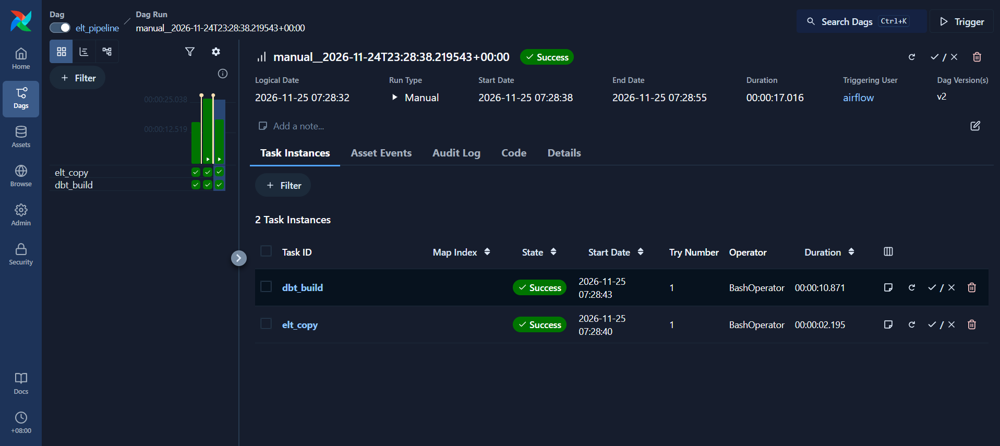
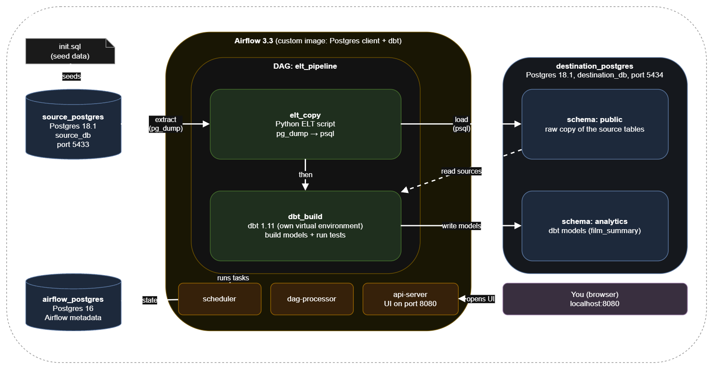
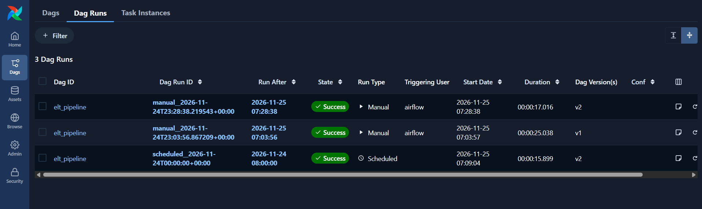
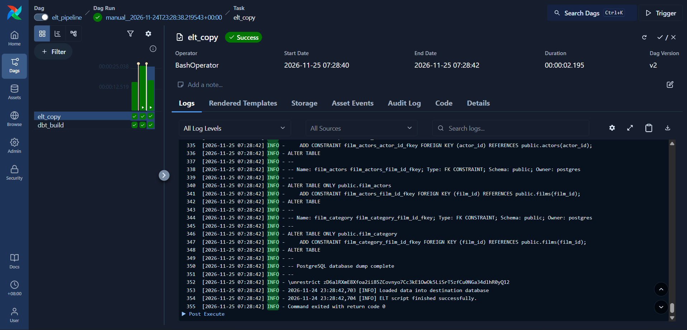
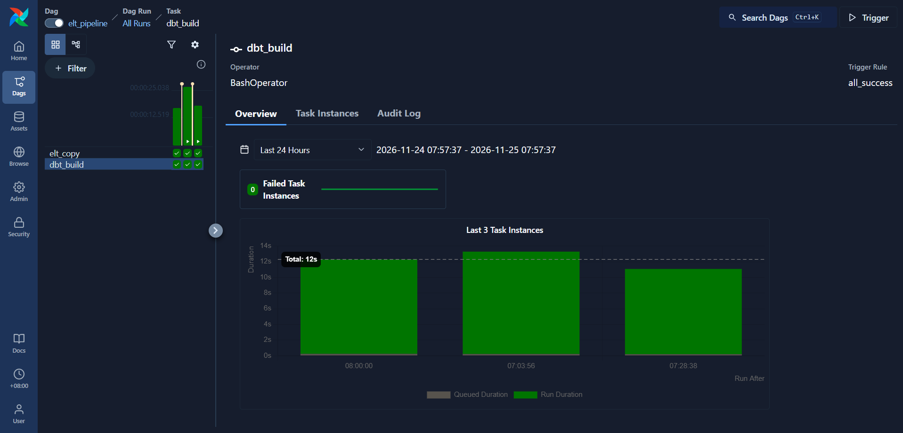
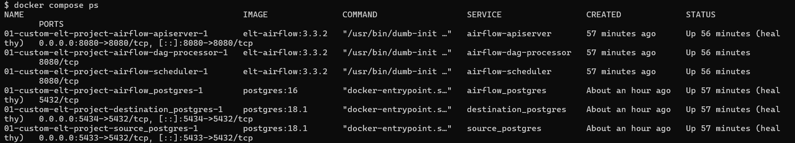
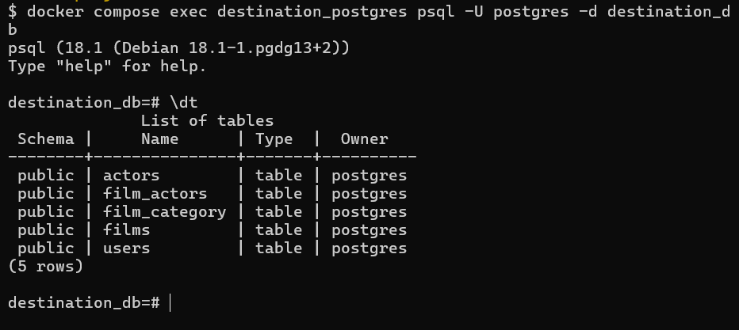
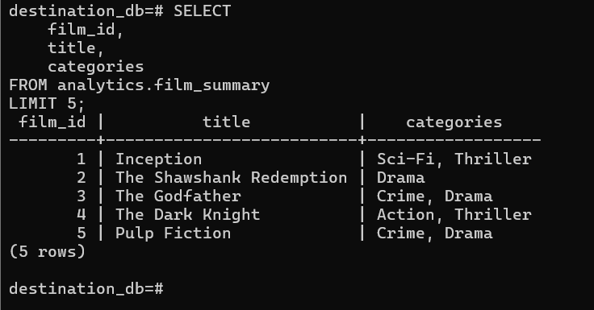
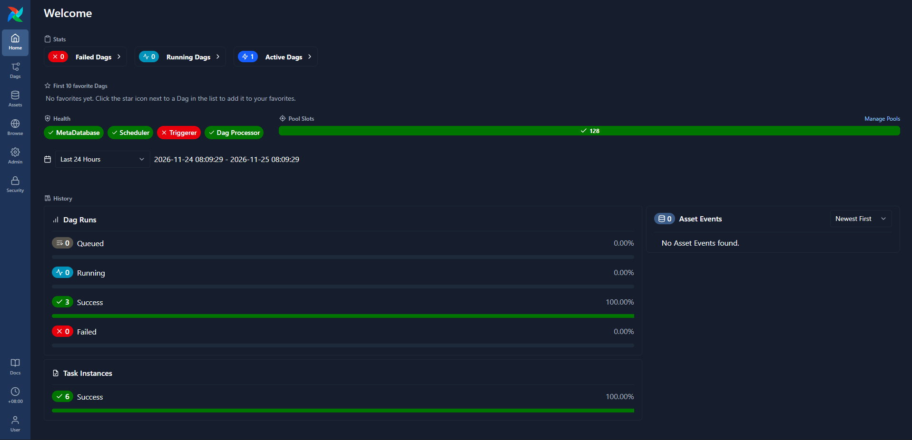
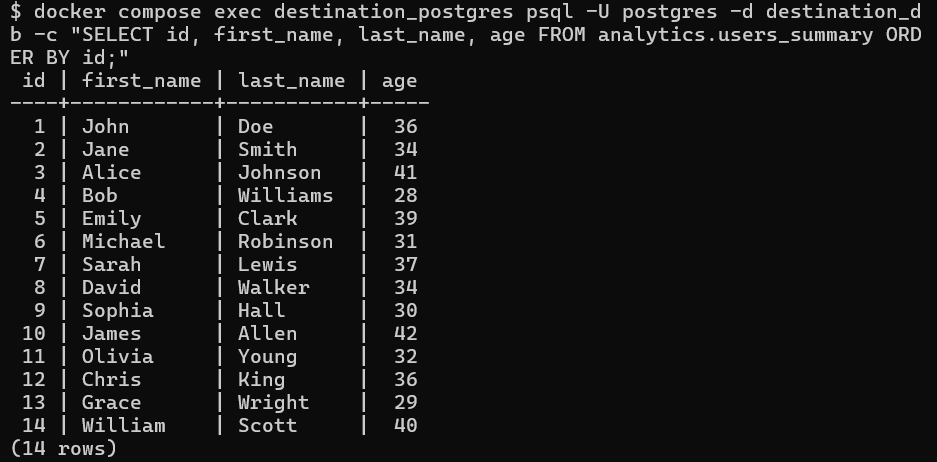

# 01. Custom ELT Project

An end-to-end ELT pipeline: Python copies data between two containerised Postgres databases, dbt transforms it, and Airflow orchestrates the run.


*The `elt_pipeline` DAG in Airflow: `elt_copy` runs first, then `dbt_build`.*

## Contents

- [Objective](#objective)
- [Purpose](#purpose)
- [Problem](#problem)
- [Why this project](#why-this-project)
- [Based on a course, rebuilt with current versions](#based-on-a-course-rebuilt-with-current-versions)
- [Architecture](#architecture)
- [Tech Stack](#tech-stack)
- [Project Structure](#project-structure)
- [Getting Started](#getting-started)
- [Configuration](#configuration)
- [How It Works](#how-it-works)
- [Results](#results)
- [Play Around](#play-around)
- [What This Project Focuses On](#what-this-project-focuses-on)
- [Trade-offs](#trade-offs)
- [Troubleshooting](#troubleshooting)
- [Roadmap](#roadmap)
- [What I Learned](#what-i-learned)
- [Credits and License](#credits-and-license)

## Objective

Build and run a small but complete ELT pipeline on one machine: copy data from a source Postgres database into a destination Postgres database, transform it with dbt, and run both steps in order with Airflow, all started from Docker Compose.

It models a common situation: data sitting in an operational database that has to be copied into a separate analytics database and shaped for analysis.

## Purpose

A hands-on way to learn the basics of data engineering: containers, SQL, an ELT script, dbt models and tests, and orchestration. This is a learning project, not a production system.

## Problem

The tutorial this project is based on uses tool versions that are now outdated. The real challenge, and the main thing this project shows, was updating each piece to current versions, debugging the configuration (usernames, passwords, environment variables, container networking), and wiring everything together until the pipeline ran successfully.

## Why this project

Rebuilding an outdated tutorial forces you to understand each tool instead of copying commands. ELT with dbt and an orchestrator such as Airflow are common patterns, so they are a sensible place to start learning.

## Based on a course, rebuilt with latest versions

This project is based on freeCodeCamp.org's [Data Engineering Course for Beginners](https://www.youtube.com/watch?v=PHsC_t0j1dU) by Justin Chau.

I followed the course through the [Docker](https://www.youtube.com/watch?v=PHsC_t0j1dU&t=194s) and [SQL](https://www.youtube.com/watch?v=PHsC_t0j1dU&t=1838s) sections. From the data pipeline section onward ([pipeline from scratch](https://www.youtube.com/watch?v=PHsC_t0j1dU&t=3872s), [dbt](https://www.youtube.com/watch?v=PHsC_t0j1dU&t=5463s), [Airflow](https://www.youtube.com/watch?v=PHsC_t0j1dU&t=7674s)) the tool versions were outdated, so I rebuilt that part with current versions instead of following it exactly. The sample data (users, films, actors) in `init.sql` comes from the course.

What changed compared with the code I started from:

| Area | Starting code | This project |
|------|---------------|--------------|
| ELT image | `python:3.8-slim` (end of life) | `python:3.13-slim` |
| Startup order | `depends_on` plus a hand-written retry loop | Healthchecks and `condition: service_healthy` |
| Credentials | Hardcoded in the compose file and script | `.env` (git-ignored) with `.env.example` |
| Re-running the load | Failed with "already exists" | `pg_dump --clean --if-exists`, and `psql` with `ON_ERROR_STOP=1` |
| dbt | Pre-built `dbt-postgres:latest` image, profile mounted from `~/.dbt` | Image built with dbt-core and dbt-postgres 1.11, `profiles.yml` in the project reading environment variables |
| Airflow | Docker socket mounted, sample secret keys in the compose file, no admin user created | Airflow 3.3 custom image that runs the tasks itself, generated keys in `.env`, admin user created at init |
| Postgres 18 data path | Old `/var/lib/postgresql/data` mount | `/var/lib/postgresql` |
| Debian version in the apt source | Hardcoded `bookworm` | Read from the base image at build time |

## Architecture


*Source and destination Postgres databases, the Airflow DAG with its two tasks, and the dbt output schema.*
```text
Source DB (Postgres)  →  ELT script (Python)  →  Destination DB (Postgres)  →  dbt models
        ▲                  pg_dump → psql          schema: public (raw copy)    schema: analytics
   init.sql seeds

        Airflow DAG `elt_pipeline`:  elt_copy  →  dbt_build
```

Airflow runs both steps inside its own custom image (it contains the Postgres client, the ELT script, and dbt in a separate virtual environment), so no Docker socket is mounted.

## Tech Stack

| Tool | Purpose |
|------|---------|
| **Python 3.13** | Extract and load script |
| **PostgreSQL 18** | Source and destination databases |
| **Docker / Docker Compose** | Containerised services |
| **dbt (dbt-core 1.11 + dbt-postgres 1.11)** | SQL-based transformations and tests |
| **Apache Airflow 3.3** | Workflow orchestration (LocalExecutor) |

## Project Structure

```text
01-custom-elt-project/
├── airflow/
│   ├── Dockerfile              # Airflow image + Postgres client + dbt (own venv)
│   ├── dags/
│   │   └── elt_pipeline.py     # DAG: elt_copy >> dbt_build
│   └── logs/                   # generated, git-ignored
├── elt_script/
│   ├── Dockerfile              # Image for running the ELT script on its own
│   └── elt_script.py           # pg_dump -> psql full copy
├── postgres_transformations/   # dbt project
│   ├── Dockerfile              # Image for running dbt on its own
│   ├── dbt_project.yml
│   ├── profiles.yml            # Reads connection details from environment variables
│   └── models/
│       ├── sources.yml
│       ├── schema.yml
│       └── film_summary.sql
├── source_db_init/
│   └── init.sql                # Creates and seeds the source database
├── figure/                     # Screenshots used in this README
├── .env.example                # Template for environment variables
├── .gitignore
├── docker-compose.yaml
└── README.md
```

## Getting Started

**Prerequisites**

- [Docker](https://docs.docker.com/get-docker/) and Docker Compose, with at least 4 GB of memory allocated to Docker
- Git

Tested on Windows with Docker Desktop, running the commands in Git Bash. <!-- TODO: add Docker Desktop version -->

**Steps**

1. **Clone the repo and move into the project**
   ```bash
   git clone https://github.com/<your-username>/data-engineering-projects.git
   cd data-engineering-projects/01-custom-elt-project
   ```

2. **Set up environment variables**
   ```bash
   cp .env.example .env
   ```
   Edit `.env`: set the database passwords and the Airflow admin password, and generate the two Airflow secrets:
   ```bash
   docker run --rm apache/airflow:3.3.2 python -c "from cryptography.fernet import Fernet; print(Fernet.generate_key().decode())"   # FERNET_KEY
   docker run --rm apache/airflow:3.3.2 python -c "import secrets; print(secrets.token_urlsafe(32))"                                 # AIRFLOW__API_AUTH__JWT_SECRET
   ```

3. **Create the Airflow folders**
   ```bash
   mkdir -p airflow/dags airflow/logs
   ```

4. **Start the services**
   ```bash
   docker compose up -d --build
   ```
   The first build takes several minutes.

5. **Run the pipeline**
   Open http://localhost:8080 and log in with the Airflow admin username and password from `.env`. Switch on the `elt_pipeline` DAG and click **Trigger**. Both tasks (`elt_copy`, `dbt_build`) should turn green.

6. **Verify the data**
   ```bash
   docker compose exec destination_postgres psql -U postgres -d destination_db -c "\dt"
   docker compose exec destination_postgres psql -U postgres -d destination_db -c "SELECT film_id, title, categories FROM analytics.film_summary ORDER BY film_id LIMIT 5;"
   ```
   Expected: tables `actors`, `film_actors`, `film_category`, `films`, `users`, and 20 rows in `analytics.film_summary`.

7. **Shut down**
   ```bash
   docker compose down        # stop containers
   docker compose down -v     # also remove database volumes
   ```

## Configuration

Settings are read from `.env`; see `.env.example` for the full list.

| Variable | Used for |
|----------|----------|
| `SOURCE_DB_*`, `DEST_DB_*` | Source and destination connections (also used by the ELT script and dbt) |
| `FERNET_KEY`, `AIRFLOW__API_AUTH__JWT_SECRET` | Airflow encryption and API token signing |
| `_AIRFLOW_WWW_USER_USERNAME`, `_AIRFLOW_WWW_USER_PASSWORD` | Airflow admin login |
| `AIRFLOW_UID` | User ID Airflow runs as (leave at 50000) |

> ⚠️ Never commit your real `.env` file. It is excluded via `.gitignore`.

| Port | Service |
|------|---------|
| `8080` | Airflow UI |
| `5433` | Source database |
| `5434` | Destination database |

## How It Works

1. **Source DB** starts and is seeded from `init.sql`.
2. **`elt_copy`** dumps the source with `pg_dump --clean --if-exists` and loads it into the destination with `psql` (`ON_ERROR_STOP=1`), so it can be re-run safely and fails on any SQL error.
3. **`dbt_build`** reads the copied `public` tables as sources, tests them, and builds `analytics.film_summary`. Models are materialised as **tables**, not views: the ELT drops and recreates the `public` tables on every run, and views depending on them would block that.
4. **Airflow** orders the two tasks, retries a failed task once, keeps the logs, and can run the DAG on a schedule.

Running the steps without Airflow still works, as a fallback or for debugging:
```bash
docker compose run --rm elt_script
docker compose run --rm dbt        # also runs elt_script first
```

## Results

**DAG runs**



**Task logs**





**Running services**



**Data in the destination database**





<!--
Optional, if you add these screenshots:

*The Triggerer shows as unhealthy because it is intentionally not deployed (it is only needed for deferrable tasks).*


-->

## Play Around

Do your experiments on a branch so `main` stays working:
```bash
git checkout -b experiments
```

| To change | Where | To apply it |
|-----------|-------|-------------|
| dbt models and tests | `postgres_transformations/models/` | Trigger the DAG, or `docker compose run --rm --no-deps dbt` (databases must be up and loaded) |
| DAG schedule, tasks, retries | `airflow/dags/elt_pipeline.py` | Wait about a minute for Airflow to re-read it |
| ELT script | `elt_script/elt_script.py` | Trigger the DAG |
| Source data or tables | `source_db_init/init.sql` | `docker compose down`, then `docker compose up -d`, then trigger the DAG |
| Packages or tools inside Airflow | `airflow/Dockerfile` | `docker compose up -d --build` |

**Ideas, easiest first**

- Add a model from `users` that calculates each user's age (worked example below)
- Build a model on top of another with `{{ ref('film_summary') }}`, such as average rating per category
- Add an `accepted_values` test on `rating`
- Change the schedule (for example `@hourly`) and watch the runs appear
- Add a third task that compares row counts between source and destination
- Copy only some tables by adding `-t films -t actors` to `pg_dump`
- Break it on purpose: set a model to `materialized='view'` and watch the next ELT run fail, then revert

<details>
<summary>Worked example: <code>users_summary</code></summary>

Create `postgres_transformations/models/users_summary.sql`:

```sql
select
    id,
    first_name,
    last_name,
    date_of_birth,
    date_part('year', age(date_of_birth))::int as age
from {{ source('source_db', 'users') }}
```

Add to `postgres_transformations/models/schema.yml`:

```yaml
  - name: users_summary
    columns:
      - name: id
        data_tests: [unique, not_null]
      - name: age
        data_tests: [not_null]
```

Run it and look at the result:

```bash
docker compose run --rm --no-deps dbt
docker compose exec destination_postgres psql -U postgres -d destination_db -c "SELECT id, first_name, last_name, age FROM analytics.users_summary ORDER BY id;"
```

dbt should finish with `PASS=13`, and the query should return 14 rows.

</details>

## What This Project Focuses On

**In scope**

- How the pieces of an ELT pipeline fit together: source, load, transform, orchestrate
- Containers: networking, healthchecks, startup order, and secrets in `.env`
- Re-runnable steps (running the pipeline twice gives the same result)
- Using current versions of every tool, and fixing what breaks when you upgrade

**Not covered**

- Large data volumes or performance tuning
- Incremental loading or change data capture
- Ingesting from APIs, files, or event streams
- Cloud warehouses and cloud infrastructure
- CI/CD, monitoring, and alerting
- Deep data modelling (there is one starter dbt model)

## Trade-offs

| Decision | Why | Cost |
|----------|-----|------|
| Full copy with `pg_dump` instead of incremental loading | Simple and easy to reason about | Reloads everything every run, which does not scale |
| dbt models as tables, not views | The ELT drops and recreates the source tables; views would block that | Rebuilt on every run, and uses more storage |
| LocalExecutor instead of Celery | One machine and no Redis or workers, so far fewer containers | Tasks share one machine, with no horizontal scaling |
| Steps run inside one custom Airflow image | No Docker socket and no host-path problems | A bigger image, with the tools duplicated in the standalone ELT and dbt images |
| Postgres as the "warehouse" | Free and local | Not a real analytical warehouse |
| Secrets in `.env` | Simple, and keeps them out of git | Not a secrets manager; fine for local use only |
| Tiny sample data | Fast runs and easy checking | Does not show behaviour at scale |
| Schedule only runs while the laptop is on | No server needed | A missed day means no run |
| No CI/CD | Keeps the project small | Nothing tests changes automatically |

## Troubleshooting

Issues hit while building this, plus a couple of known gotchas.

| Symptom | Cause | Fix |
|---------|-------|-----|
| `apt-get install postgresql-client-18` fails with exit code 100 (`libpq5` depends on `libldap-2.5-0`) | The Python base image moved to a newer Debian, but the apt source line was hardcoded to `bookworm` | Read the codename from `/etc/os-release` (`${VERSION_CODENAME}-pgdg`) |
| dbt: `Could not find profile named ...` | `profile:` in `dbt_project.yml` and the top-level key in `profiles.yml` differ; dbt names can't contain hyphens or start with a digit | Use one identical name in both files (here `elt`) |
| dbt: `could not translate host name "destination_postgres"` | The databases aren't running, for example after `docker compose down` or with `--no-deps` | `docker compose up -d`, then run the DAG once so the tables exist |
| `Set FERNET_KEY in .env` (or similar) when running Compose | A required Airflow variable is missing | Fill in all variables from `.env.example` |
| Compose can't find the dbt build context | The folder name doesn't match `postgres_transformations` | Rename the folder to match `docker-compose.yaml` |
| Red underline on `dbt_project.yml` in VS Code (`env_var ... not found`) | The VS Code dbt extension runs on your machine, where the environment variables aren't set | Harmless; disable the extension for this workspace if it bothers you |
| Airflow containers restart or run out of memory | Docker has less than about 4 GB | Raise the memory limit in Docker Desktop settings |
| Triggerer shows as unhealthy on the Airflow dashboard | It is intentionally not deployed | Ignore it; it is only needed for deferrable tasks |
| Database data is not kept after recreating a Postgres 18 container | Postgres 18 images keep data under `/var/lib/postgresql`, not `/var/lib/postgresql/data` | Mount the volume at `/var/lib/postgresql` |

## Roadmap

- [x] Project scaffolding and environment configuration
- [x] Source database initialisation (`init.sql`)
- [x] Dockerised, re-runnable ELT script
- [x] dbt models and tests
- [x] Orchestration with Apache Airflow
- [x] Add the architecture diagram to `figure/`

Ideas I may explore next:

- Ingest from an API instead of a database dump
- Incremental loading
- CI/CD (lint and test on every change)
- A cloud data warehouse

## What I Learned

- How to take an outdated tutorial and update it to current tool versions instead of copying it as written
- How to debug configuration problems (credentials, environment variables, container networking) until the whole stack runs
- How ELT, dbt, and Airflow fit together at a basic level

## Credits and License

- Course: [Data Engineering Course for Beginners](https://www.youtube.com/watch?v=PHsC_t0j1dU) by Justin Chau, on freeCodeCamp.org
- Original course project: [justinbchau/custom-elt-project](https://github.com/justinbchau/custom-elt-project/tree/main)

[← Back to main README](../README.md)