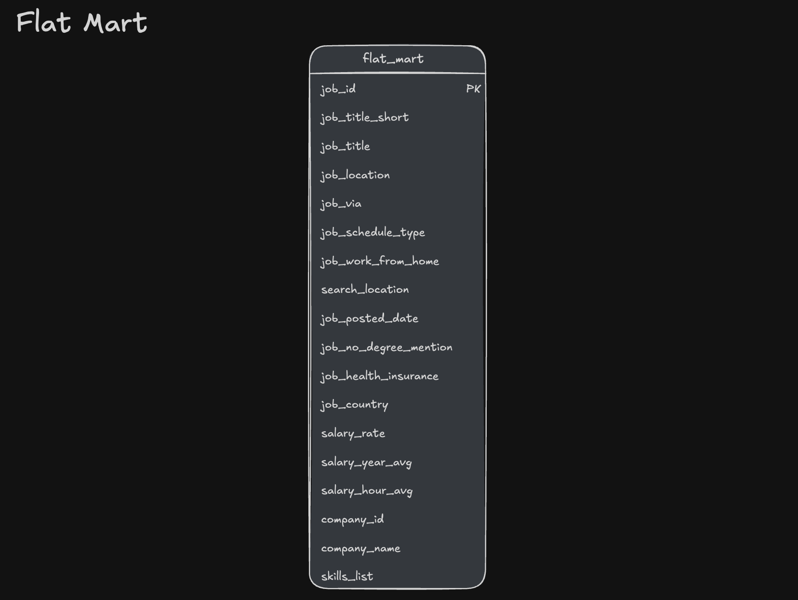
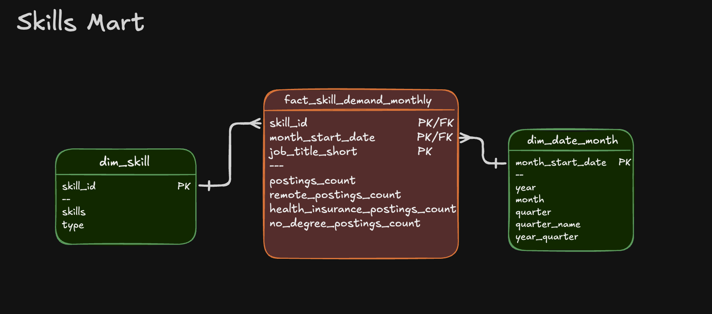
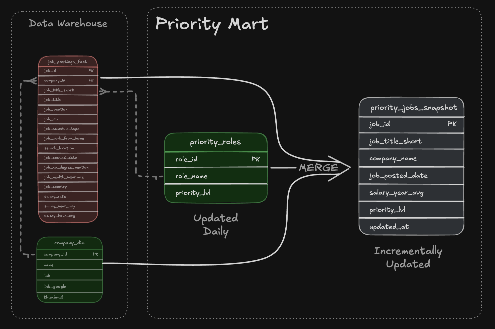

# Data Warehouse & Mart Build: Production ETL Pipeline

An end-to-end data engineering pipeline that transforms raw CSV files from Google Cloud Storage into a normalized star schema data warehouse, then builds analytical data marts.


## Executive Summary

- **Pipeline scope:** Built a complete **ETL pipeline** from raw CSVs to a star schema warehouse to analytical marts
- **Data modeling:** Designed a **star schema** with fact tables, dimensions, and bridge tables for many-to-many relationships
- **ETL development:** Implemented **extract, transform, load** processes with idempotent operations and data quality checks
- **Mart architecture:** Created **specialized data marts** (flat, skills, priority) with additive measures and incremental update patterns

If you only have a minute, review these:

1. [`01_create_tables_dw.sql`](./01_create_tables_dw.sql) - star schema design
2. [`06_update_priority_mart.sql`](./06_update_priority_mart.sql) - incremental update using `MERGE`
3. [`build_dw_marts.sql`](./build_dw_marts.sql) - master script that runs the whole pipeline

## Problem & Context

**Challenge:** Data teams need a single source of truth, a data warehouse, to enable consistent, reliable analysis across the organization. Additionally, specialized data marts are required to optimize resources by pre-aggregating data for specific business use cases, reducing query complexity and improving performance for common analytical patterns.

## Tech Stack

- **Query engine:** DuckDB for fast OLAP-style analytical queries
- **Language:** SQL (DDL for schema design, DML for data loading and transformation)
- **Data model:** Star schema (fact, dimension, and bridge tables)
- **Development:** VS Code for SQL editing + terminal for the DuckDB CLI
- **Automation:** Master SQL script for pipeline orchestration
- **Version control:** Git/GitHub for versioned SQL scripts
- **Storage:** Google Cloud Storage for source CSV files

## Project Structure

```text
2_DW_Mart_Build/
├── 01_create_tables_dw.sql       # Star schema DDL
├── 02_load_schema_dw.sql         # Load CSVs from GCS into the warehouse
├── 03_create_flat_mart.sql       # Denormalized flat mart
├── 04_create_skills_mart.sql     # Time-series skills mart
├── 05_create_priority_mart.sql   # Priority roles + jobs snapshot
├── 06_update_priority_mart.sql   # Incremental MERGE update
├── build_dw_marts.sql            # Master script (runs the full pipeline)
├── dw_marts.duckdb               # Local database file (git-ignored)
└── README.md
```

## Pipeline Architecture


The pipeline transforms job posting CSVs from Google Cloud Storage into a normalized star schema data warehouse, then builds specialized analytical data marts. BI tools (Excel, Power BI, Tableau, Python) consume from both the warehouse and the marts.

### Data Warehouse

The data warehouse implements a star schema with `company_dim`, `skills_dim`, `job_postings_fact`, and `skills_job_dim` tables.

- **SQL files:**
  - [`01_create_tables_dw.sql`](./01_create_tables_dw.sql) - defines the star schema with 4 core tables
  - [`02_load_schema_dw.sql`](./02_load_schema_dw.sql) - extracts CSVs from GCS and loads them into the warehouse tables
- **Purpose:** star schema serving as the single source of truth for analytical queries
- **Grain:** one row per job posting in the fact table (`job_postings_fact`)

### Flat Mart

Denormalized table with all dimensions for ad-hoc queries.



- **SQL file:** [`03_create_flat_mart.sql`](./03_create_flat_mart.sql) - builds a denormalized table with all dimensions joined
- **Purpose:** quick ad-hoc queries
- **Grain:** one row per job posting with all dimensions joined

### Skills Mart

Time-series skill demand analysis with additive measures.



- **SQL file:** [`04_create_skills_mart.sql`](./04_create_skills_mart.sql) - builds the time-series skill demand mart
- **Purpose:** analysis of skill demand over time with additive measures
- **Grain:** `skill_id + month_start_date + job_title_short`
- **Key feature:** all measures are additive (counts/sums) for safe re-aggregation

### Priority Mart

Priority role tracking with incremental updates using `MERGE` operations.



- **SQL files:**
  - [`05_create_priority_mart.sql`](./05_create_priority_mart.sql) - initial build of priority roles and jobs snapshot
  - [`06_update_priority_mart.sql`](./06_update_priority_mart.sql) - **incremental update using `MERGE`** (upsert pattern)
- **Purpose:** track priority roles and job snapshots with incremental update capabilities
- **Grain:** one row per job posting with priority level assignment
- **Key feature:** `MERGE` demonstrates a production-ready upsert pattern (`INSERT`, `UPDATE`, `DELETE` in a single statement)

## How to Run

<!-- TODO: verify these commands against your build_dw_marts.sql -->
**Prerequisites:** [DuckDB CLI](https://duckdb.org/docs/installation) and an internet connection (source CSVs are read from Google Cloud Storage).

```bash
# From this folder: open (or create) the local database
duckdb dw_marts.duckdb

# Inside the DuckDB shell: run the full pipeline
.read build_dw_marts.sql
```

The master script runs the numbered SQL files in order. All scripts are idempotent, so they can be re-run safely.

## Data Engineering Skills Demonstrated

### ETL Pipeline Development

- **Extract:** direct CSV loading from Google Cloud Storage using DuckDB's `httpfs` extension
- **Transform:** data normalization, type conversion (`CAST`, `DATE_TRUNC`), and quality filtering
- **Load:** idempotent table creation with `DROP TABLE IF EXISTS` patterns
- **Incremental updates:** `MERGE` operations for upsert patterns (`INSERT`, `UPDATE`, `DELETE` in a single statement)
- **Orchestration:** master SQL script (`build_dw_marts.sql`) for automated pipeline execution

### Dimensional Modeling

- **Star schema design:** fact table (`job_postings_fact`) with dimension tables (`company_dim`, `skills_dim`)
- **Bridge tables:** many-to-many relationship handling (`skills_job_dim`, `bridge_company_location`, `bridge_job_title`)
- **Grain definition:** proper fact table granularity (skill + month, company + title + location + month)
- **Additive measures:** counts and sums that can be safely re-aggregated at any level
- **Surrogate keys:** sequential ID generation using CTEs with self-joins (optional company_mart build only)

### Advanced SQL Techniques

- **DDL operations:** `CREATE TABLE`, `DROP TABLE`, `CREATE SCHEMA` for schema management
- **DML operations:** `INSERT INTO ... SELECT` with explicit column mapping from CSV sources
- **`MERGE` operations:** incremental updates using `MERGE INTO` with `WHEN MATCHED`, `WHEN NOT MATCHED`, and `WHEN NOT MATCHED BY SOURCE` clauses
- **CTEs:** common table expressions for complex transformations and boolean flag conversions
- **Date functions:** `DATE_TRUNC('month')`, `EXTRACT(quarter)` for temporal dimension creation
- **String functions:** `STRING_AGG` for concatenation, `REPLACE` for data cleaning
- **Boolean logic:** `CASE WHEN` conversions for aggregating flags (remote, health insurance, no degree)

### Data Quality & Production Practices

- **Idempotency:** all scripts can be safely re-run without side effects
- **Data validation:** verification queries at each pipeline step to ensure data integrity
- **Type safety:** proper data type definitions (`VARCHAR`, `INTEGER`, `DOUBLE`, `BOOLEAN`, `TIMESTAMP`)
- **Schema organization:** separate schemas (`flat_mart`, `skills_mart`, `priority_mart`, `company_mart`) for logical separation
- **Error handling:** structured script execution with clear error messages and progress reporting

[← Back to SQL projects](../README.md)